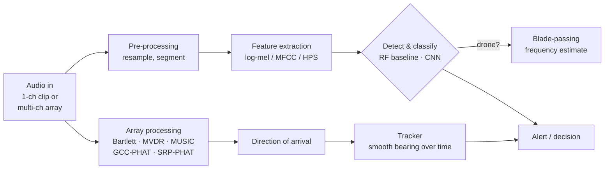

# 3. System architecture

EchoHawk is organised as a small Python library plus runnable example scripts.
Every algorithm lives in the library; every script is a thin demo that wires
algorithms together and writes a figure.

## 3.1 The pipeline

In words: a sound clip is cleaned up and turned into features; a classifier
decides drone-or-not and (optionally) reads off the blade-passing frequency. In
parallel, if multiple microphones are available, the array stage estimates the
direction of arrival, which a tracker smooths over time. Detection plus direction
feed the final decision.

## 3.2 The library modules

| Module | Responsibility | Key functions |
|---|---|---|
| `simulate.py` | Generate synthetic drones, confusers, noise, and microphone-array captures, so everything runs without data | `drone_signal`, `vehicle_signal`, `make_detection_dataset`, `uca_positions`, `simulate_array` |
| `features.py` | Turn sound into features | `log_mel_spectrogram`, `mfcc`, `harmonic_product_spectrum`, `feature_vector` |
| `models.py` | Classifiers | `build_baseline` (Random Forest / SVM), `build_cnn` (PyTorch) |
| `beamforming.py` | Array direction-finding | `bartlett_spectrum`, `mvdr_spectrum`, `music_spectrum`, `gcc_phat`, `srp_phat`, `estimate_doa` |
| `track.py` | Smooth DOA over time | `AzimuthTracker` |
| `evaluate.py` | Honest metrics & plots | `pd_at_pfa`, `plot_roc`, `plot_confusion` |
| `data_io.py` | Load real datasets with leakage-safe grouping | `load_drone_audio_dataset`, `load_dads`, `load_dregon_flight` |

## 3.3 The demos and the figures they make

Each script writes one or more PNGs into `results/`. This is how the project is
reproduced end-to-end.

| Script | What it shows | Figure(s) |
|---|---|---|
| `examples/01_detection_demo.py` | Synthetic drone-vs-confuser detection | `roc.png`, `confusion.png` |
| `examples/02_array_doa_demo.py` | Direction-finding on a simulated 8-mic array; error vs SNR | `doa_spectra.png`, `doa_error_vs_snr.png` |
| `examples/03_features_bpf_demo.py` | Spectrogram + blade-passing-frequency estimate | `features_bpf.png` |
| `examples/04_detection_real.py` | Random-Forest detection on real recorded audio | `roc_real.png`, `confusion_real.png` |
| `examples/05_doa_real.py` | Direction-finding on real array data (needs DREGON) | `doa_real.png` |
| `examples/06_train_cnn.py` | Train the CNN on real audio; compare to the baseline | `roc_cnn_real.png`, `confusion_cnn.png`, `cnn_training.png` |
| `examples/07_doa_tracking_demo.py` | Track a moving source's bearing over time | `doa_tracking.png` |

## 3.4 Design choices worth knowing

- **Runnable with no data.** The simulator means a newcomer can clone the repo
  and reproduce most figures immediately. Real-data scripts degrade gracefully
  when the dataset is absent.
- **Library vs scripts.** Algorithms are kept free of file paths and plotting so
  they are easy to test and reuse; the scripts handle I/O and figures.
- **Honesty is built in.** The same evaluation helpers (`evaluate.py`) and
  leakage-safe splitting (`data_io.py` groups) are used everywhere, so synthetic
  and real results are measured the same careful way (see
  [chapter 6](06_evaluation_rigor_and_leakage.md)).
- **Vectorised array math.** The beamformers compute a whole azimuth grid at once
  per frequency bin, so the DOA demos run in seconds.

➡ Next: [Detection & classification](04_detection_and_classification.md).
